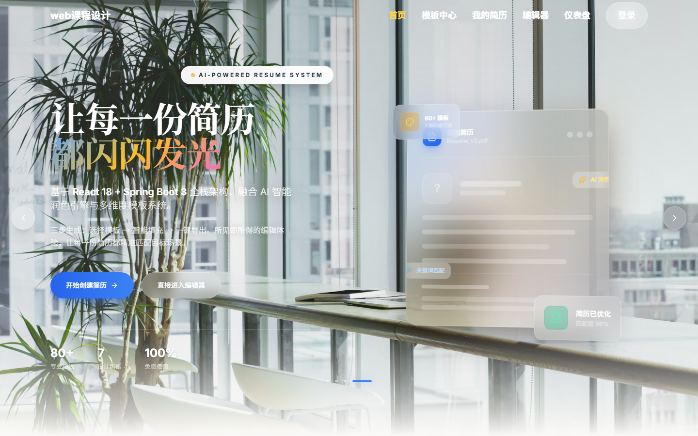
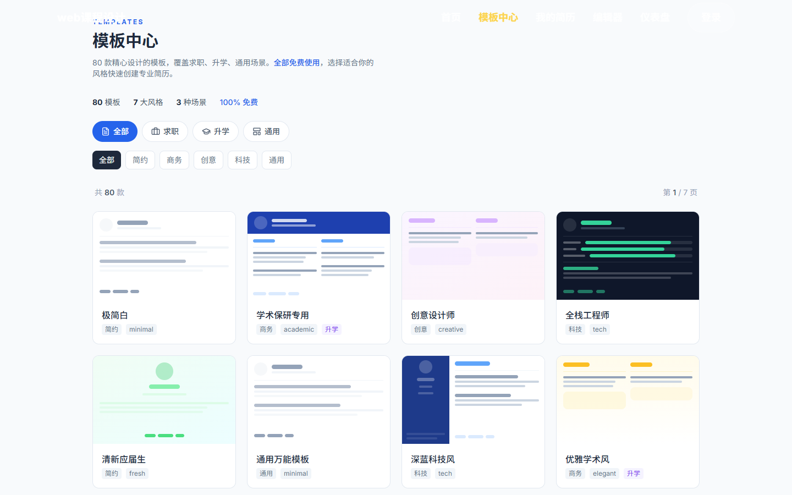
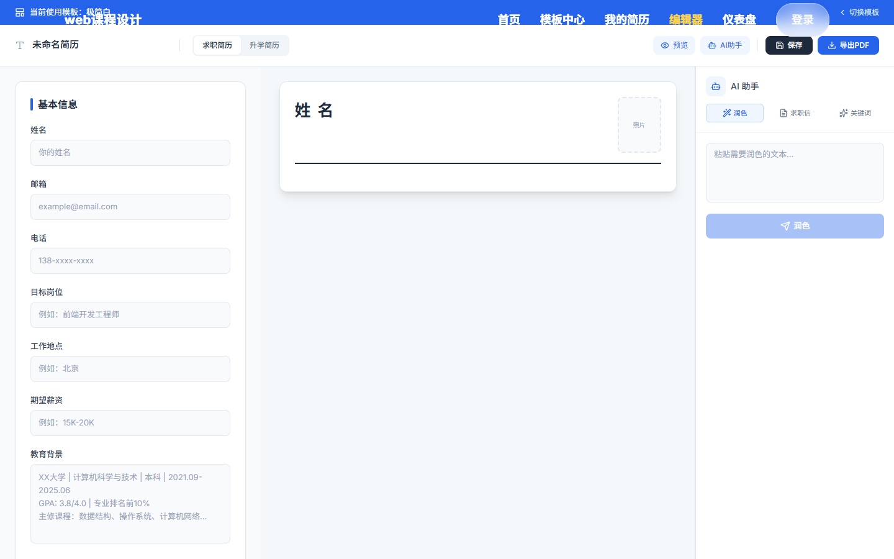
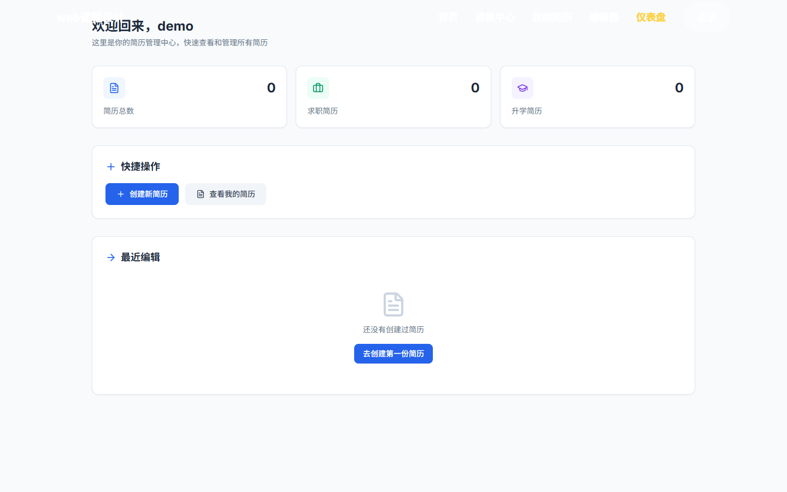
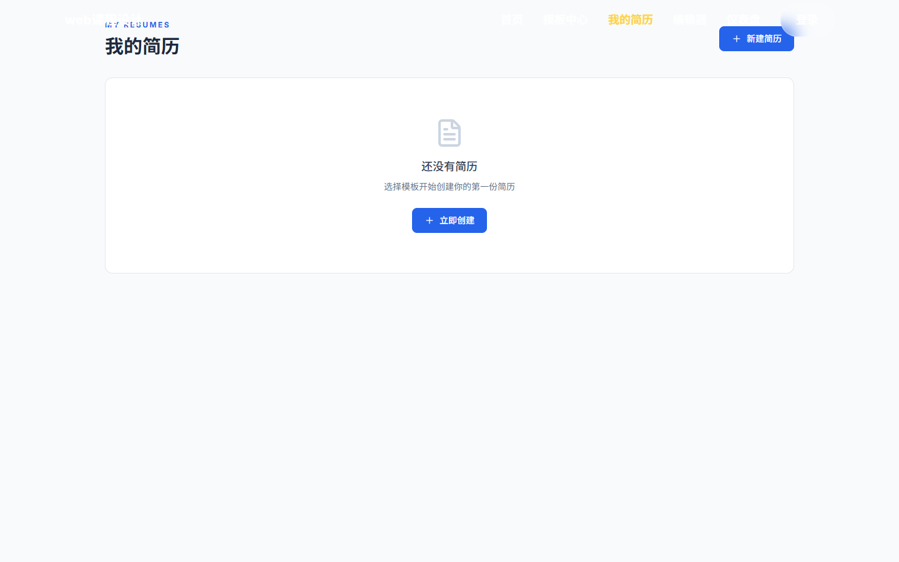

# 简历生成系统（Resume Builder）

在线简历生成系统：选模板 → 填表 → 实时预览 → 保存 / 导出 PDF，覆盖「求职 / 升学」两种场景，并接入 AI 润色、求职信生成。

本仓库把同一门课程设计前后 **三套实现 + 一个独立登录服务** 收在一起，方便对照各阶段的技术选型。

| 子目录 | 技术栈 | 定位 | 状态 |
|---|---|---|---|
| **[`app-ts/`](app-ts)** | React 18 · Vite · TypeScript · Hono · tRPC · Drizzle ORM · MySQL · Tailwind + shadcn | **主实现（最终版）**：落地页、模板中心（80 套模板）、编辑器、我的简历、仪表盘、管理员、AI 助手 | ✅ 本地跑通（登录 → 编辑器 → 保存） |
| [`backend-spring/`](backend-spring) | Java 17 · Spring Boot 3.5 · MyBatis · JWT · MySQL | 另一版后端：简历 CRUD、模板、AI 接口 | ✅ `mvn package` 通过，需 MySQL |
| [`frontend-vue/`](frontend-vue) | Vue 2.6 · Element UI · Axios | 早期版本前端（路由与首页脚本未补全，**残缺**） | ⚠️ 能启动，页面不完整 |
| [`login-service/`](login-service) | Java 17 · Spring Boot 3.2 · MyBatis · PageHelper | 更早期的登录 / 用户管理服务（含后台用户列表静态页） | ⚠️ 独立项目，库名 `resume_db` |
| [`sql/`](sql) | — | `backend-spring` 的建库建表脚本；`app-ts` 的最小迁移 | ✅ |

## 主实现界面（`app-ts`，实际运行截图）



| 模板中心（80 套 / 7 风格 / 3 场景） | 简历编辑器 |
|---|---|
|  |  |

| 仪表盘 | 我的简历 |
|---|---|
|  |  |

---

## 1. app-ts（主实现）

**技术栈**：React 18 + TypeScript + Vite 7、Hono + tRPC 风格 API、Drizzle ORM、MySQL 8 / MariaDB 10.4、Tailwind + shadcn/ui、Kimi 开放平台（OAuth + 文本生成）。

**页面**：`/` 落地页、`/templates` 模板中心、`/editor` 编辑器、`/my-resumes` 我的简历、`/dashboard` 仪表盘、`/admin/users` 用户管理、`/peots` 管理、`/login` 登录。

### 启动

```bash
cd app-ts
cp .env.example .env          # 填 DATABASE_URL、APP_SECRET 等

npm install
npm run db:push               # 按 db/schema.ts 建表（Drizzle）

# 已有库（旧版）需要补口令字段：
# mysql -uroot resume_db < ../sql/app-ts-add-password.sql

npm run dev                   # http://localhost:3000
```

首次使用在 `/login` 页面点「注册」创建账号（用户名 ≥2 位、口令 ≥6 位），或用接口：

```bash
curl -X POST http://localhost:3000/api/auth/register \
  -H 'Content-Type: application/json' \
  -d '{"username":"demo","email":"demo@example.com","password":"123456"}'
```

### 登录方式

| 方式 | 说明 |
|---|---|
| 本地用户名 + 口令 | `POST /api/auth/login`、`/api/auth/register`、`/api/auth/me`。口令用 `node:crypto` 的 scrypt 加盐哈希存 `users.password`，`unionId` 记为 `local:<username>` |
| Kimi OAuth | 原有链路保留（`/api/oauth/callback`）。需要能访问 `KIMI_AUTH_URL` 的授权服务 |

两种方式签发的都是同一个会话 cookie（`kimi_sid`，JWT/HS256，密钥为 `APP_SECRET`），所以 `/api/trpc/*` 的鉴权链路完全复用。

### 数据

- 模板、简历、用户、分类、教育、技能等表由 `db/schema.ts` 定义，`npm run db:push` 自动建。
- `db/seed.ts`、`db/seed-peots.ts` 提供种子数据脚本。

---

## 2. backend-spring（另一版后端）

```bash
mysql -uroot -p < sql/schema.sql        # 建库 + 3 套初始模板

cd backend-spring
export DB_PASSWORD=你的口令              # 默认空
export DEEPSEEK_API_KEY=sk-xxxx         # 可选，不配则 AI 返回占位文案
mvn spring-boot:run                     # http://localhost:8080
```

接口（前缀 `/api`）：`/user/register`、`/user/login`、`/resume`（CRUD）、`/template/list`、`/ai/summary|polish|cover-letter`。

AI 由 `utils/DeepSeekUtil` 调用 DeepSeek `chat/completions`（JDK 自带 `java.net.http`，无额外 SDK）；**未配置 `DEEPSEEK_API_KEY` 时降级为占位文案**。

## 3. frontend-vue（早期版本，残缺）

```bash
cd frontend-vue
npm install && npm run serve      # http://localhost:8081，/api 代理到 :8080
```

⚠️ `src/router/index.js` 只注册了 4 个路由（登录/注册/编辑器被注释掉），`Home.vue` 的 `<script>` 是占位注释，`Templates.vue` 用了后端不存在的 `tags` 字段。**能启动但页面是空壳**，保留仅供对照。

## 4. login-service（更早期的登录模块）

```bash
cd login-service
mvn spring-boot:run        # http://localhost:8080，静态页 /user_list.html
```

库名 `resume_db`；`application.yml` 里 `mybatis.mapper-locations` 指向不存在的 XML（实际用注解 Mapper），该配置可删。

---

## 已知问题

1. **`app-ts` 的落地页文案**：原写「React 18 + Spring Boot 3 全栈架构」，但实际后端是 Hono + Drizzle，已改为真实架构。
2. `backend-spring` 口令明文存储，生产需改 BCrypt；`JwtUtil` 密钥已支持 `JWT_SECRET` 环境变量。
3. `backend-spring` 的 `JwtInterceptor` 存在但未在 `WebConfig` 注册，只有显式带 `Authorization` 头的接口会校验。
4. 三套实现的数据库名不统一（`resume` / `resume_db`），不能混跑。
5. `frontend-vue` 与 `login-service` 为早期版本，未做完整联调。
6. 没有单元测试。

## 安全提示

`.env` 内含 Kimi 开放平台的 `APP_SECRET`、`KIMI_API_KEY` 与数据库连接串，**已在 `.gitignore` 中排除，仓库只保留 `.env.example`**。请勿把真实密钥提交到仓库。

## License

课程设计作品，仅供学习参考。
